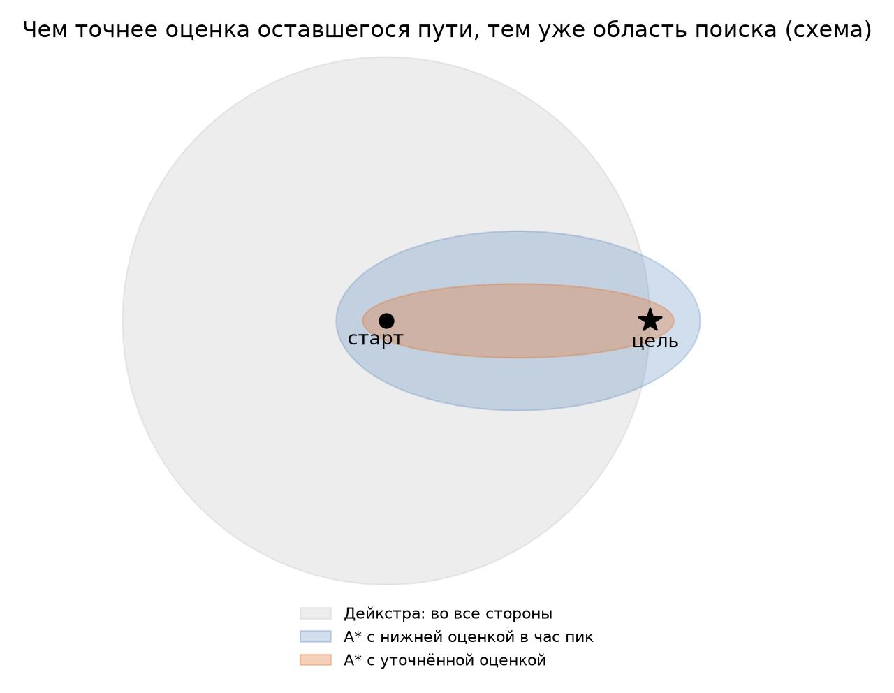
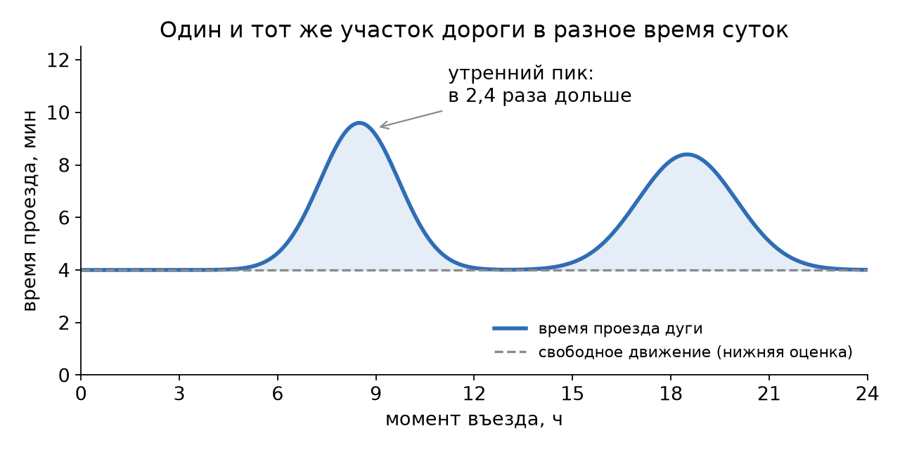
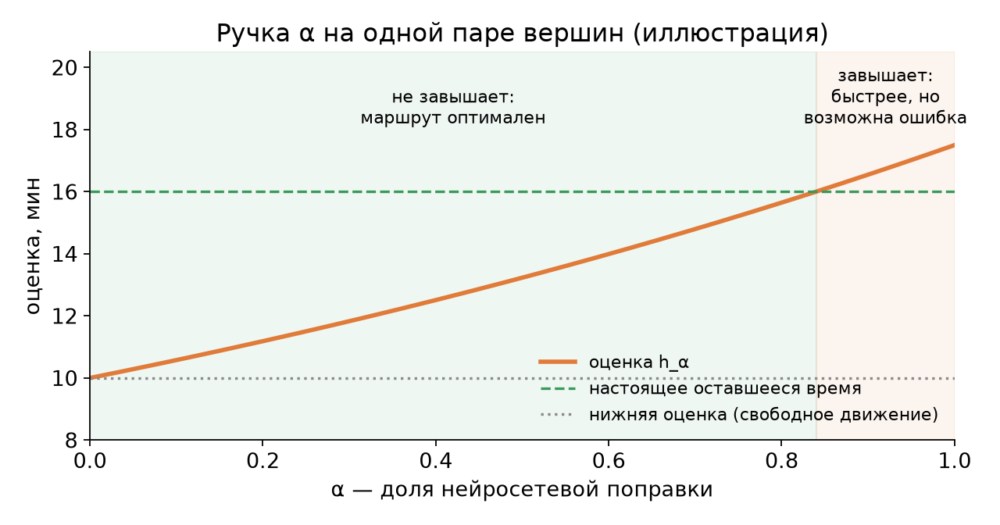

# Как учесть пробки в эвристике A*

Ночью дорога из Химок в Бутово занимает минут сорок, а в половине девятого утра навигатор покажет больше часа. Для алгоритма поиска маршрута это две разные задачи на одном и том же графе. Я пишу ВКР о том, как быстрее искать маршрут, когда время проезда зависит от времени суток. В этой статье расскажу, почему классический A* в час пик работает заметно хуже, чем ночью, и какую поправку к нему я сейчас проверяю. Сразу оговорюсь: замеров здесь не будет, эксперимент ещё идёт, а профили загрузки дорог у меня синтетические.

## Дейкстра ищет во все стороны

Дорожную сеть представляют ориентированным графом. Перекрёстки становятся вершинами, участки дорог между ними — дугами, и у каждой дуги есть вес, время проезда. Алгоритм Дейкстры достаёт из очереди вершину, до которой быстрее всего добраться, обновляет её соседей и повторяет это, пока не дойдёт до цели. Маршрут выходит оптимальным, но порядок обхода ничего не знает о том, где цель. Чтобы найти путь из Химок в Бутово, Дейкстра переберёт все перекрёстки, до которых ехать меньше, чем до Бутова, включая Зеленоград, который лежит в обратную сторону.

## A* смотрит в сторону цели

A* ([Hart, Nilsson, Raphael, 1968](https://doi.org/10.1109/TSSC.1968.300136)) меняет одну деталь: вершины в очереди упорядочены по сумме уже потраченного времени и оценки оставшегося пути до цели. Эту оценку называют эвристикой. Перекрёстки, которые уводят от цели, получают большую сумму, очередь доходит до них позже, а часто не доходит вовсе. Чем ближе оценка к настоящему оставшемуся времени, тем у́же полоса графа, которую обходит алгоритм.

*Схема, не замер: так область поиска сужается с ростом точности оценки.*

Эвристика должна удовлетворять одному условию. Если она ни для одной вершины не завышает оставшееся время, A* гарантированно вернёт оптимальный маршрут. Такую эвристику называют допустимой. Простейший пример для дорог — расстояние по прямой, делённое на максимальную скорость: быстрее, чем по прямой на пределе разрешённого, всё равно не доедешь. На практике берут оценки поточнее. В приёме ALT (Goldberg, Harrelson, 2005) заранее считают расстояния от всех вершин до нескольких опорных и оценивают оставшийся путь через неравенство треугольника. Я использую 16 опорных вершин.

## Когда вес дуги зависит от времени

В навигаторе вес дуги — функция, которая говорит, сколько минут займёт участок, если въехать на него в момент τ. Запрос тогда состоит из трёх частей: откуда, куда и во сколько выезжаю.

*Профиль в моём эксперименте синтетический: пики заданы по классу дороги, а не взяты из реальных данных.*

Дейкстра работает и здесь, если выполнено свойство FIFO: въехав на участок позже, раньше с него не съедешь ([Kaufman, Smith, 1993](https://doi.org/10.1080/10248079308903779)). Постоять на обочине, чтобы обогнать самого себя, нельзя. Пока FIFO выполнено, Дейкстра, раскрывающий вершины в порядке времени прибытия, по-прежнему находит оптимальный маршрут. Эту версию называют TD-Dijkstra.

С A* сложнее. Допустимую оценку для таких сетей обычно строят по весам свободного движения, беря для каждой дуги самое короткое время проезда за сутки ([Delling, Wagner, 2007](https://doi.org/10.1007/978-3-540-72845-0_5)). Ночью эта оценка почти совпадает с реальностью. В восемь утра участок с графика выше проезжается в 2,4 раза дольше, а оценка остаётся ночной. Она по-прежнему допустима, только пользы от неё мало: сумма «пройдено плюс осталось» почти перестаёт различать вершины, и область поиска расползается обратно к кругу Дейкстры. Хуже всего эвристика работает утром и вечером, то есть как раз тогда, когда к навигатору больше всего запросов.

Для совсем быстрых ответов есть иерархии сжатия вроде TCH и CATCHUp, но их нужно перестраивать при обновлении данных о загрузке, а A* работает с графом как есть. Поэтому за его эвристику стоит побороться.

## Поправлять оценку вместо того, чтобы угадывать время

Первое, что приходит в голову, — научить нейросеть предсказывать оставшееся время целиком. [Liashenko и Globa (2026)](https://doi.org/10.32620/reks.2026.1.12) попробовали это с LightGBM и графовыми сетями, и A* с такими предсказаниями раскрыл больше вершин, чем с обычной оценкой. Сеть ошибается в обе стороны, а при завышении алгоритму приходится возвращаться к уже раскрытым вершинам. Выигрыш у них появился, когда сеть стала предсказывать скорость, а эвристику считали по формуле, которая сохраняет допустимость.

Я проверяю промежуточный вариант. Допустимая оценка по свободному движению h_LB остаётся, а сеть предсказывает только множитель: во сколько раз в это время суток реальный путь от вершины v до цели t длиннее этой оценки. Ночью множитель близок к единице, в пик он больше. Чтобы управлять риском, в показатель экспоненты добавлен коэффициент α от 0 до 1:

$$h_\alpha(v, t, \tau) = h_{LB}(v, t) \cdot e^{\alpha \cdot g(v, t, \tau)}$$

Здесь g — маленький перцептрон с двумя скрытыми слоями по 64 нейрона. На вход он получает координаты v и t, расстояние между ними, саму нижнюю оценку и время суток. Время кодируется синусом и косинусом, чтобы 23:59 и 00:00 оказались рядом.

При α = 0 множитель равен единице, и получается обычный допустимый A* с оптимальным маршрутом. При α = 1 поправка работает в полную силу: оценка ближе к правде, но иногда её превышает, и маршрут может оказаться чуть медленнее оптимального. Промежуточные значения позволяют выбрать, сколько точности маршрута отдать за скорость поиска, причём сеть для этого переобучать не нужно.

*Иллюстрация на одной паре вершин: где-то между 0 и 1 оценка пересекает настоящее оставшееся время.*

Идея похожа на взвешенный A* ([Pohl, 1970](https://doi.org/10.1016/0004-3702(70)90007-X)), где эвристику умножают на постоянный коэффициент больше единицы. У Поля есть гарантия: маршрут хуже оптимального не больше чем во столько же раз. У меня коэффициент свой для каждой вершины и момента времени, гарантия пропадает, и ошибку маршрута приходится измерять. Чтобы она была единственной ценой, я не раскрываю вершины повторно. Тогда число раскрытий не превышает числа вершин графа, а всё, что теряется из-за завышения, видно в отклонении времени маршрута от оптимального.

## Данные для обучения почти бесплатны

Сети нужны точные времена в пути для множества троек «откуда, куда, когда». Звучит дорого, но TD-Dijkstra, запущенный из вершины v в момент τ, можно не останавливать на одной цели, и за один проход он выдаст точное время до всех вершин графа. Поэтому выборку я собираю так: беру случайную вершину и случайный момент в пределах суток, делаю один запуск и из результата отбираю цели, следя, чтобы коротких и длинных поездок было поровну. Сеть учится предсказывать логарифм отношения точного времени к нижней оценке. Вершины-источники для обучения и для проверки не пересекаются, иначе я бы мерил, насколько хорошо сеть запомнила пары, которые уже видела.

## Чего я пока не знаю

Граф для эксперимента — Москва с областью из OpenStreetMap, только дороги для легковых машин. Я сравниваю TD-Dijkstra, A* с нижней оценкой и A* с поправкой при α = 0,25; 0,5; 0,75 и 1. Для каждого запроса записываю число раскрытых вершин, полное время запроса вместе с вычислением сети и отклонение времени в пути от оптимального. Запросы беру ночью, в утренний пик и днём, короткие и длинные поровну.

Главный вопрос — окупится ли сеть по времени. Перцептрон считается на процессоре для каждой раскрытой вершины, и если раскрытий станет вдвое меньше, а каждое подорожает втрое, ускорения не будет вовсе. Второй вопрос — переживут ли выводы переход с синтетических профилей на реальные: открытых суточных профилей скоростей по Москве я пока не нашёл. Цифры появятся во второй части, когда досчитаются замеры.

*Работа выполняется на кафедре инженерной кибернетики НИТУ МИСИС.*
