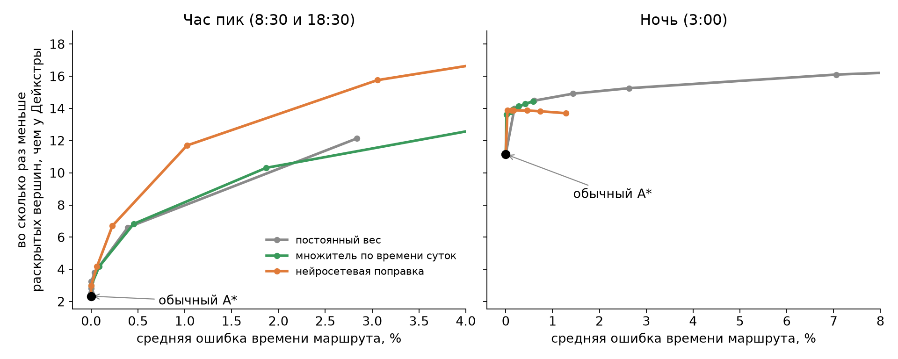

# Как учесть пробки в эвристике A*

В три часа ночи A* ищет маршрут по Москве в 11 раз экономнее алгоритма Дейкстры: перебирает в 11 раз меньше перекрёстков. В половине девятого утра на тех же самых запросах от этого выигрыша остаётся 2,5 раза. Алгоритм тот же, просто на дорогах пробки.

Я пишу диплом про поиск маршрута на дорогах, где время проезда зависит от времени суток, и решил проверить, можно ли вернуть A* в час пик его ночную форму. Попробовал две поправки: таблицу из 96 чисел и крошечную нейросеть на 169 параметров. Обе поднимают выигрыш в час пик до 10–12 раз, а маршрут выходит в среднем на 1–2% дольше идеального. Дальше рассказываю, как это устроено, и показываю цифры по 1800 запросам.

## Как ищут маршрут

Карту дорог для навигатора превращают в граф. Перекрёстки становятся вершинами, участки дорог между ними — рёбрами, и у каждого ребра есть время проезда.

Дейкстра ищет путь, расходясь от старта кругами: сначала всё, до чего ехать минуту, потом две минуты, потом три. О цели он не знает ничего. Если ехать из Тушина в Марьино, он заодно обшарит Ховрино, хотя оно в противоположной стороне, просто потому что до Ховрина ближе.

A* ([Hart, Nilsson, Raphael, 1968](https://doi.org/10.1109/TSSC.1968.300136)) к уже потраченному времени прибавляет прикидку, сколько ещё ехать до цели. Перекрёстки, которые уводят в сторону, получают большую сумму, и до них очередь доходит поздно или не доходит вовсе. Главное правило для прикидки — никогда не завышать. Пока оценка честная, A* гарантированно находит самый быстрый маршрут, и чем она точнее, тем меньше лишнего он перебирает.

Хорошую честную оценку для дорог даёт приём ALT (Goldberg, Harrelson, 2005). На краях графа выбирают 16 опорных точек и заранее считают время от каждого перекрёстка до каждой из них. Дальше работает неравенство треугольника: если от опорной точки до цели 30 минут, а до тебя 10, то тебе до цели никак не меньше 20.

## Что ломают пробки

В навигаторе время проезда участка зависит от того, когда на него въезжаешь ([Kaufman, Smith, 1993](https://doi.org/10.1080/10248079308903779)). Запрос звучит как «откуда, куда и во сколько выезжаю». Дейкстра с этим справляется: раз выехавший позже не может приехать раньше, достаточно перебирать перекрёстки в порядке времени прибытия. Такую версию называют TD-Dijkstra.

*Время проезда одного участка за сутки. Пунктир — то, что «думает» про этот участок A*.*

С оценкой для A* сложнее. Чтобы она никогда не завышала, её считают по пустым ночным дорогам ([Delling, Wagner, 2007](https://doi.org/10.1007/978-3-540-72845-0_5)). Ночью это почти правда. В восемь утра участок с графика едет в 2,4 раза дольше, а оценка по-прежнему ночная. Для A* все перекрёстки начинают выглядеть одинаково многообещающими, и поиск расползается по городу почти как у Дейкстры.

## На чём я проверял

Граф — Москва внутри МКАД из OpenStreetMap: 19 473 перекрёстка и 40 229 участков, по которым ездят машины. Ночная скорость задана по типу дороги, от 90 км/ч на магистралях до 25 км/ч во дворах. Пробки на каждом участке зависят от типа дороги, близости к центру и направления: утром все едут в центр, вечером обратно.

Профили я подгонял под открытые цифры, пока они не сошлись. Магистрали у МКАД в утренний пик едут у меня 38 км/ч, у «Яндекса» МКАД утром даёт 37. Главные улицы у Садового кольца — 24 км/ч против 27 у «Яндекса» на самом Садовом. Средняя скорость по городу в вечерний пик — 21,8 км/ч, Дептранс называет 21.

Запросы нужны разные, от поездки за хлебом до поездки через весь город. Поэтому я запускал TD-Dijkstra из случайного перекрёстка и брал целью 64-й перекрёсток по порядку, потом 128-й, 256-й и так далее до 16 384-го. Пятьдесят стартов на каждое из четырёх времён (3:00, 8:30, 13:00, 18:30) дали 1800 запросов, в пик от двух минут до полутора часов езды. Все алгоритмы работают на одном и том же коде, скомпилированном через numba, и отличаются только оценкой. Для каждого запроса я записывал, сколько перекрёстков перебрано, сколько это заняло времени и насколько маршрут дольше самого быстрого.

*Синие столбики — обычный A*. Ночью он перебирает в 11 раз меньше Дейкстры, днём в 3,9 раза, в пики в 2,2–2,5 раза.*

## Поправка к оценке

Раз в пик оценка слишком оптимистична, её можно домножить на что-нибудь больше единицы. Самый старый вариант — взвешенный A* ([Pohl, 1970](https://doi.org/10.1016/0004-3702(70)90007-X)): оценку умножают на постоянное число, скажем на 2. Поиск сужается, маршрут иногда выходит не самым быстрым, но хуже оптимального не больше чем в те же 2 раза. Беда в том, что число одно на все случаи. В 3:00 оценку трогать почти не нужно, а в 8:30 её надо увеличивать вдвое.

Поэтому я сделал множитель зависящим от того, где мы и когда:

$$h_\alpha(v, t, \tau) = h_{ALT}(v, t) \cdot e^{\alpha \cdot g(v, t, \tau)}$$

h_ALT — честная оценка от перекрёстка v до цели t. g — предсказание, во сколько раз настоящая дорога длиннее этой оценки, если оказаться в v в момент τ (в логарифме, чтобы удобнее учить). α — ручка смелости от 0 до 1. При нуле получается обычный A* с гарантией оптимальности, при единице поправка работает в полную силу. Иногда она будет завышать, и маршрут выйдет чуть хуже. Это цена, и её я как раз и мерил.

Сам множитель я получал двумя способами. Первый совсем простой: таблица по времени суток, одно число на каждые 15 минут, всего 96 чисел. Каждое — среднее «во сколько раз реальность хуже оценки» в этот промежуток. Второй — нейросеть с двумя слоями по 8 нейронов, 169 параметров. Она получает координаты перекрёстка и цели, их удалённость от центра и друг от друга, саму оценку ALT и время суток. Таблица знает только время, а сеть ещё и направление. Например, в 8:30 поездка из центра на окраину идёт против потока и тормозит меньше, чем поездка в центр, и сеть это учитывает.

## Откуда данные для обучения

Для обучения нужны точные времена в пути для огромного числа поездок «откуда, куда, когда». Звучит дорого, но у TD-Dijkstra есть приятное свойство. Если не останавливать его на одной цели, за один проход он посчитает точное время от старта до всех 19 473 перекрёстков сразу.

Я сделал 2500 таких проходов из случайных точек в случайное время и из каждого взял по 240 целей, поровну близких и далёких. Вышло 600 тысяч примеров за 34 секунды на ноутбуке, а сеть на них учится 4 секунды. На стартах, которых сеть при обучении не видела, сеть в половине случаев ошибается в множителе меньше чем на 5,3%, а таблица — меньше чем на 8,2%.

## Что получилось

Тут главный вопрос — сколько ускорения получаешь за каждый процент проигрыша в маршруте. Каждая точка на графике ниже — одна настройка: разные α для поправок и разные веса для взвешенного A*.

*Слева — утренний и вечерний пик, справа — ночь. Чем выше и левее кривая, тем лучше.*

В час пик нейросеть при α = 1 перебирает в 11,7 раза меньше перекрёстков, чем Дейкстра, а маршрут в среднем всего на 1% дольше лучшего. Таблица даёт 10,3 раза, но ошибается вдвое сильнее, на 1,9%. Взвешенный A* при той же ошибке в 1% выигрывает около 8 раз.

Правая половина графика показывает, где взвешенный A* сыплется. Вес 2, неплохой для пика, ночью удлиняет маршрут в среднем на 7%, а каждый двадцатый — почти на 28%. Поправки, которые знают время суток, ночью почти ничего не трогают и держат ошибку в пределах 0,5%.

Сводка по пикам (8:30 и 18:30, 900 запросов):

| | Перебор меньше, чем у Дейкстры | Быстрее Дейкстры по времени | Средняя ошибка маршрута | 95% маршрутов хуже не больше чем на |
|---|---|---|---|---|
| Обычный A* | в 2,3 раза | в 1,3 раза | 0 | 0 |
| Взвешенный A*, вес 2 | в 6,6 раза | в 3,8 раза | 0,4% | 2,4% |
| Таблица по времени суток | в 10,3 раза | в 7,3 раза | 1,9% | 9,8% |
| Нейросеть 8×8 | в 11,7 раза | в 5,3 раза | 1,0% | 5,3% |

На длинных поездках разница ещё заметнее. Если ехать через полгорода, обычный A* в пик перебирает в 2,1 раза меньше Дейкстры, таблица — в 16 раз, нейросеть — в 23 раза. Вот один такой запрос в 8:30, с северо-запада на юго-восток:

*Точки — перекрёстки, которые алгоритм успел перебрать. Дорога занимает 80,6 минуты у Дейкстры и обычного A* и 80,8 минуты с поправкой.*

Дейкстра перебрал 18 090 перекрёстков, почти весь город. Обычный A* отрезал восточный край и остановился на 14 203. С поправкой поиск прошёл узкой полосой через центр и уложился в 2405 перекрёстков, в 7,5 раза меньше. Маршрут получился на 15 секунд дольше.

По чистому времени таблица обгоняет сеть. Её множитель — это одно чтение из массива, а сеть приходится пересчитывать для каждого нового перекрёстка. Поэтому сеть должна быть маленькой. Сеть 64×64 точнее совсем чуть-чуть (12,5 раза против 11,7), но считается так долго, что поиск становится медленнее Дейкстры. Сеть 8×8 в пик отвечает в 5,3 раза быстрее Дейкстры и в 4 раза быстрее обычного A*.

## Какую поправку брать

Если нужно просто и быстро, хватит 96 чисел. Их можно посчитать за минуту прямо на своём графе, и в час пик поиск ускорится в 7 раз ценой маршрутов в среднем на 2% длиннее. Если важнее качество маршрутов, нейросеть 8×8 при том же ускорении поиска ошибается вдвое меньше. Худшие 5% её маршрутов проигрывают лучшему до 5,3%, у таблицы — до 9,8%. Граф перестраивать не нужно ни в том, ни в другом случае: обе поправки ставятся поверх обычного A*.

Дальше хочу проверить то же самое на Москве с областью. Там перекрёстков в десятки раз больше, каждый шаг поиска дороже, и сокращение перебора в 12 раз должно сильнее сказаться на времени ответа.
