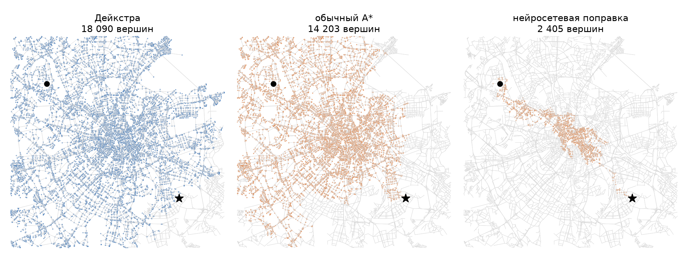

# Как учесть пробки в эвристике A*

Ночью A* на дорожном графе Москвы находит маршрут, раскрыв в 11 раз меньше перекрёстков, чем алгоритм Дейкстры. В половине девятого утра на тех же запросах выигрыш падает до 2,5 раза. Я пишу ВКР о поиске маршрута на дорогах, где время проезда зависит от времени суток, и проверил две поправки к эвристике A*: таблицу из 96 множителей по времени суток и нейросеть со 169 параметрами. Обе возвращают A* в час пик выигрыш в 10–12 раз, а маршрут получается в среднем на 1–2% дольше оптимального. Ниже расскажу, откуда берётся провал, как устроены поправки и что показали 1800 запросов по Москве.

## Дейкстра, A* и честная оценка

Дорожную сеть представляют ориентированным графом: перекрёстки становятся вершинами, участки дорог — дугами со временем проезда. Дейкстра раскрывает вершины в порядке времени, за которое до них можно доехать, и ничего не знает о том, где цель. Чтобы найти путь из Тушина в Марьино, он переберёт все перекрёстки, до которых ехать меньше, чем до Марьина, в том числе Ховрино, которое лежит совсем в другой стороне.

A* ([Hart, Nilsson, Raphael, 1968](https://doi.org/10.1109/TSSC.1968.300136)) упорядочивает вершины по сумме пройденного времени и оценки оставшегося пути до цели. Если оценка никогда не завышает оставшееся время, найденный маршрут гарантированно оптимален, и такую оценку называют допустимой. Чем ближе она к правде, тем меньше вершин алгоритм тратит впустую. Для дорог хорошо работает приём ALT (Goldberg, Harrelson, 2005): заранее считаются расстояния от всех вершин до 16 опорных точек на краях графа, и по неравенству треугольника получается нижняя оценка до любой цели.

## Почему в час пик A* слепнет

В навигаторе время проезда дуги — функция момента, в который на неё въезжаешь ([Kaufman, Smith, 1993](https://doi.org/10.1080/10248079308903779)). Запрос тогда звучит как «откуда, куда и во сколько выезжаю». Дейкстра справляется и с этим: если въехавший позже не может съехать раньше, то, раскрывая вершины в порядке времени прибытия, он находит оптимальный маршрут. Эту версию называют TD-Dijkstra.

*Время проезда одного участка в течение суток. Пунктир — оценка, по которой работает A*.*

Допустимую оценку для A* в такой сети считают по свободному движению, то есть по самому короткому времени проезда каждой дуги за сутки ([Delling, Wagner, 2007](https://doi.org/10.1007/978-3-540-72845-0_5)). Ночью она почти совпадает с реальностью. Утром участок с графика выше едет в 2,4 раза дольше, а оценка остаётся ночной. Сумма «пройдено плюс осталось» перестаёт различать вершины, которые ведут к цели и от неё, и область поиска расползается почти до размеров Дейкстры.

## Стенд

Граф — Москва в пределах МКАД из OpenStreetMap: 19 473 перекрёстка и 40 229 участков дорог, по которым можно проехать на машине. Скорость свободного движения задана по классу дороги, от 90 км/ч на магистралях до 25 км/ч во дворах. Профиль загрузки каждого участка зависит от класса дороги, расстояния до центра и направления: утром тяжелее едут к центру, вечером из центра. Профили я подогнал под открытые цифры. Магистрали у МКАД в утренний пик едут у меня 38 км/ч (у «Яндекса» МКАД утром 37), главные улицы в районе Садового кольца — 24 км/ч (у «Яндекса» Садовое 27), а средняя скорость по городу в вечерний пик получилась 21,8 км/ч при 21 км/ч у Дептранса.

Запросы я выбирал так, чтобы поровну было коротких поездок по району и длинных через весь город. Из случайной вершины запускается TD-Dijkstra, и целью становится вершина, которую он раскрыл 64-й, 128-й и так далее до 16 384-й. Пятьдесят стартов на каждое из четырёх времён суток (3:00, 8:30, 13:00 и 18:30) дают 1800 запросов, длина маршрутов в пик — от пары минут до полутора часов. Все варианты поиска работают на одном коде, скомпилированном через numba, и отличаются только эвристикой. Главная метрика — во сколько раз меньше вершин раскрыто по сравнению с Дейкстрой (среднее геометрическое по запросам). Ещё я записывал время запроса и то, насколько найденный маршрут дольше оптимального.

*Синие столбики — обычный A* с ALT. Днём он сокращает поиск в 3,9 раза, в пики — в 2,2–2,5 раза.*

## Поправка к оценке

Раз нижняя оценка в пик слишком оптимистична, её можно домножить на поправку. Самый старый способ — взвешенный A* ([Pohl, 1970](https://doi.org/10.1016/0004-3702(70)90007-X)): оценка умножается на постоянное число больше единицы, поиск становится уже, а маршрут может выйти хуже оптимального, но не больше чем во столько же раз. Проблема в том, что вес один на все случаи, тогда как в 3:00 оценку почти не нужно поправлять, а в 8:30 её надо увеличить вдвое.

Я делаю поправку зависящей от того, где и когда мы находимся:

$$h_\alpha(v, t, \tau) = h_{ALT}(v, t) \cdot e^{\alpha \cdot g(v, t, \tau)}$$

Здесь h_ALT — нижняя оценка ALT от вершины v до цели t, τ — момент, когда мы оказались в v, g — предсказанный логарифм отношения настоящего оставшегося времени к оценке. Коэффициент α от 0 до 1 регулирует смелость: при α = 0 получается обычный допустимый A*, при α = 1 поправка используется целиком. Если поправка иногда завышает оставшееся время, вершину могут раскрыть раньше, чем к ней найден лучший путь. Повторно я вершины не раскрываю, поэтому число раскрытий не превышает размера графа, а вся цена ошибки видна в длине маршрута.

g я получал двумя способами. Первый — таблица множителей по времени суток: 96 чисел, по одному на каждые 15 минут, каждое равно среднему отношению «настоящее время / оценка» в этом интервале. Второй — нейросеть, перцептрон с двумя скрытыми слоями по 8 нейронов и 169 параметрами. Ей на вход подаются координаты вершины и цели, их расстояния до центра и друг до друга, сама оценка ALT и время суток в виде синуса и косинуса. Сеть видит то, чего не видит таблица: поездка из центра на окраину в 8:30 идёт против основного потока и замедляется меньше, чем поездка в центр.

## Данные почти бесплатно

Чтобы обучить таблицу и сеть, нужны точные времена в пути для множества троек «откуда, куда, когда». Здесь помогает свойство TD-Dijkstra: если не останавливать его на одной цели, за один проход он выдаёт точное время от стартовой вершины до всех 19 473 вершин графа. Я сделал 2500 таких запусков из случайных вершин в случайное время суток и из каждого взял по 240 целей, поровну близких и далёких. Получилось 600 тысяч обучающих пар за 34 секунды на ноутбуке. Сеть 8×8 обучается на них за 4 секунды. На парах из вершин, которых она не видела при обучении, медианная ошибка отношения у сети составляет 5,3%, а у таблицы по времени суток — 8,2%.

## Результаты

Главный график показывает, сколько ускорения можно купить за каждый процент ошибки маршрута. Точки на кривых соответствуют разным α для поправок и разным весам для постоянного варианта.

*Слева — утренний и вечерний пик, справа — ночь. Чем выше и левее кривая, тем лучше.*

В час пик нейросетевая поправка при α = 1 сокращает поиск в 11,7 раза, и маршрут получается в среднем на 1% дольше оптимального. Таблица по времени суток даёт сокращение в 10,3 раза при вдвое большей ошибке, 1,9%. Постоянный вес при такой же ошибке в 1% выигрывает около 8 раз. В правой половине видно, почему постоянный вес плох как универсальное решение: ночью вес 2 ухудшает маршрут в среднем на 7%, а каждый двадцатый маршрут — почти на 28%. Обе поправки, которые учитывают время, ночью держат ошибку в пределах 0,5%.

Сводка по пикам (8:30 и 18:30, 900 запросов):

| Эвристика | Раскрытий меньше, чем у Дейкстры | Суммарное время меньше | Средняя ошибка маршрута | 95% маршрутов хуже не более чем на | Маршрут оптимален |
|---|---|---|---|---|---|
| Обычный A* (ALT) | в 2,3 раза | в 1,3 раза | 0 | 0 | 100% |
| Постоянный вес 2 | в 6,6 раза | в 3,8 раза | 0,4% | 2,4% | 77% |
| Таблица по времени суток, α = 1 | в 10,3 раза | в 7,3 раза | 1,9% | 9,8% | 55% |
| Нейросеть 8×8, α = 1 | в 11,7 раза | в 5,3 раза | 1,0% | 5,3% | 60% |

Чем длиннее поездка, тем сильнее разница. На запросах, где цель — примерно 8000-я по удалённости вершина, то есть поездки через полгорода, обычный A* в пик сокращает поиск в 2,1 раза, таблица — в 16 раз, а нейросеть — в 23 раза. Вот как это выглядит на одном запросе в 8:30 с северо-запада на юго-восток:

*Точки — раскрытые вершины. Дорога занимает 80,6 минуты у Дейкстры и обычного A* и 80,8 минуты с нейросетевой поправкой.*

Дейкстра раскрыл 18 090 вершин, то есть почти весь город. Обычный A* отрезал только восточный край и раскрыл 14 203 вершины. A* с поправкой прошёл узкой полосой через центр и раскрыл 2405 вершин, в 7,5 раза меньше Дейкстры, а маршрут вышел на 15 секунд дольше.

По времени таблица выигрывает у нейросети, потому что её множитель — это чтение одного числа из массива. Сеть приходится считать для каждой новой вершины, примерно 1,4 раза на одно раскрытие, и при сети 64×64 эти вычисления съедают всё ускорение. Маленькой сети 8×8 хватает, чтобы почти не потерять в точности (11,7 раза против 12,5 у сети 64×64), а суммарное время запросов в пик у неё в 5,3 раза меньше, чем у Дейкстры, и в 4 раза меньше, чем у обычного A*.

## Что из этого следует

Если нужен самый простой способ ускорить A* в пробках, достаточно 96 чисел. Их можно посчитать за минуту по запускам Дейкстры на собственном графе, и в час пик поиск становится в 7 раз быстрее при ошибке маршрута около 2%. Если важна точность, нейросеть 8×8 при той же степени сокращения поиска вдвое снижает и среднюю ошибку, и хвост: 95% маршрутов хуже оптимальных не больше чем на 5,3% против 9,8% у таблицы. Обе поправки не требуют перестраивать граф и работают поверх обычного A* с ALT.

Следующий шаг — граф Москвы с областью, где вершин в десятки раз больше и каждое раскрытие стоит дороже. Там сокращение поиска в 12 раз должно сильнее сказываться на времени ответа.
