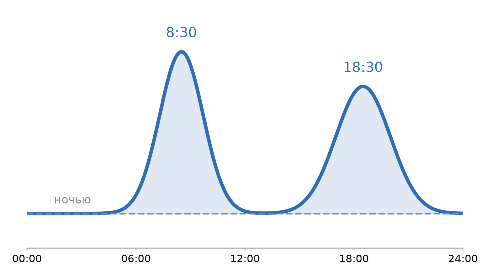
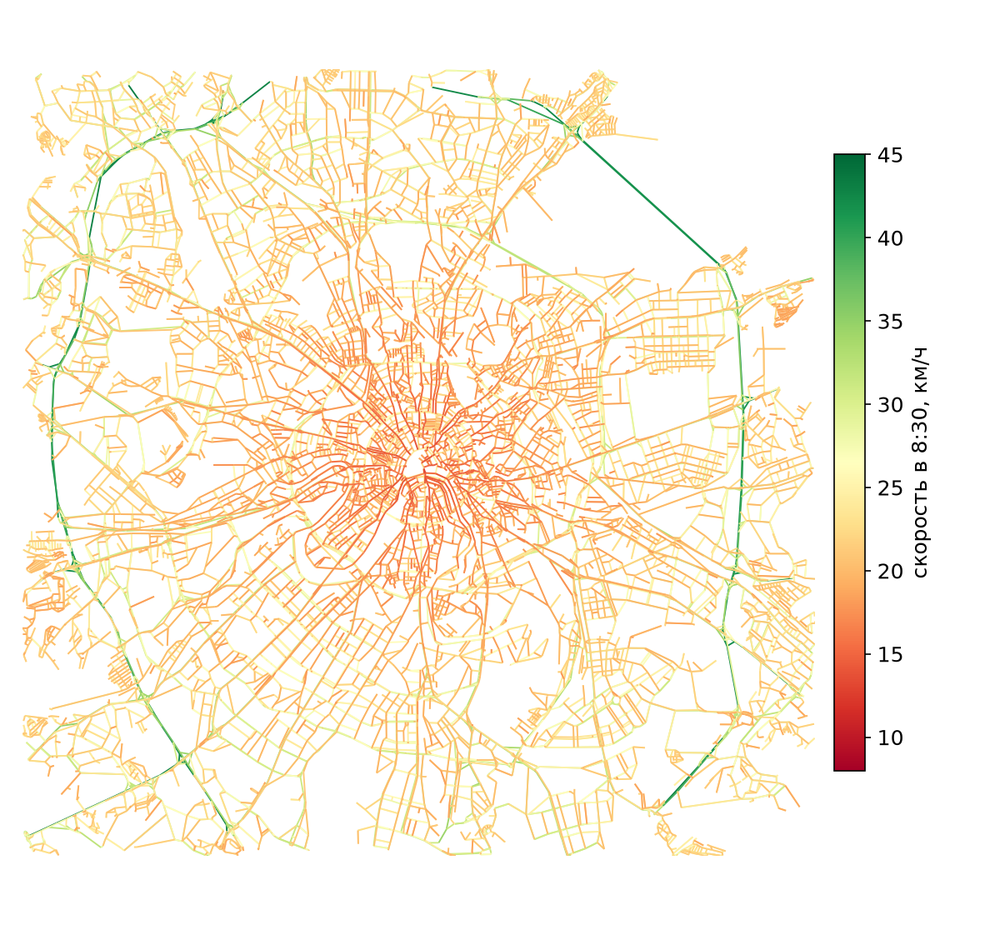
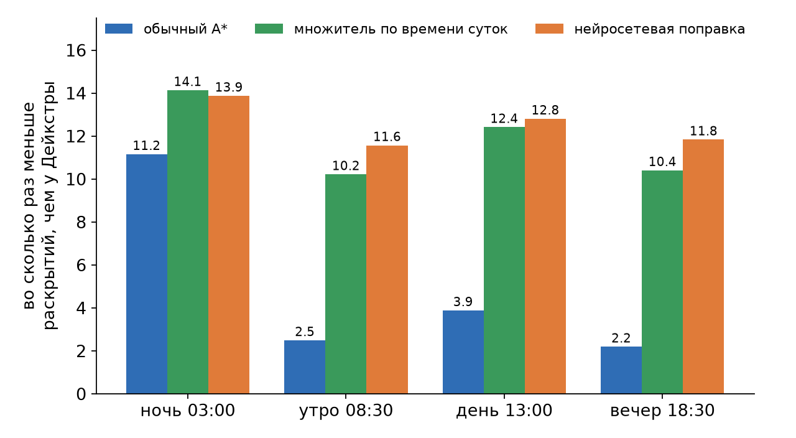
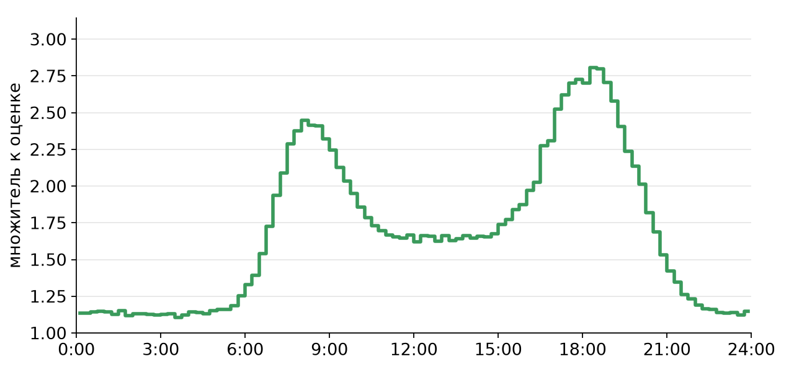
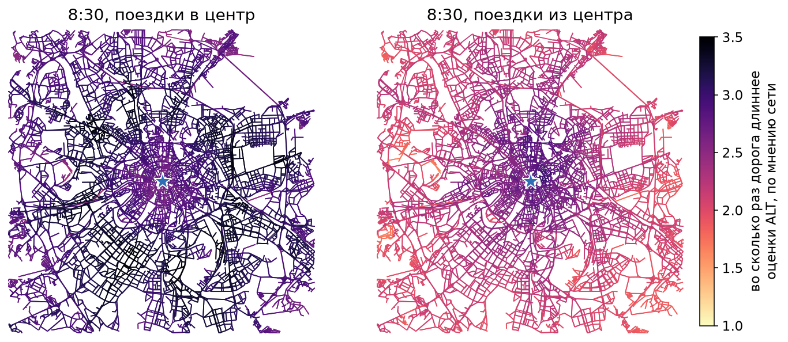
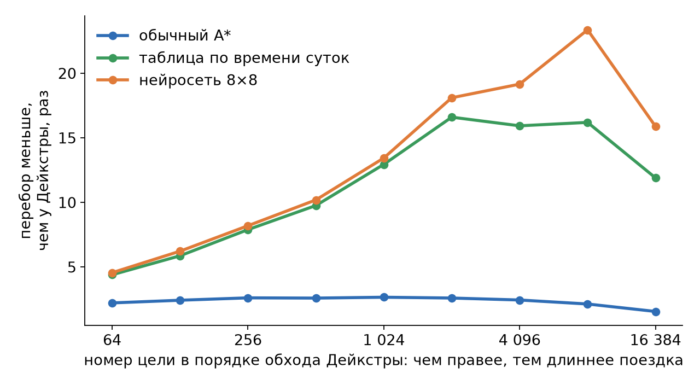
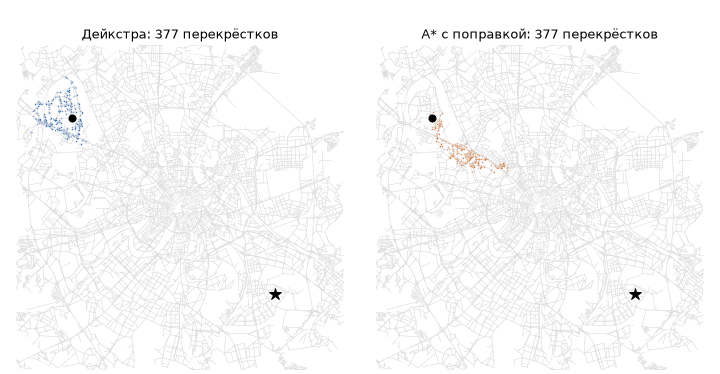

# Как учесть пробки в эвристике A*



В три часа ночи A* ищет маршрут по Москве в 11 раз экономнее алгоритма Дейкстры: перебирает в 11 раз меньше перекрёстков. В половине девятого утра на тех же самых запросах от этого выигрыша остаётся 2,5 раза. Алгоритм тот же, просто на дорогах пробки.

Я занимаюсь поиском маршрута на дорогах, где время проезда зависит от времени суток, и решил проверить, можно ли вернуть A* в час пик его ночную форму. Попробовал две поправки: таблицу из 96 чисел и крошечную нейросеть на 169 параметров. Обе поднимают выигрыш в час пик до 10–12 раз, а маршрут выходит в среднем на 1–2% дольше идеального. Дальше расскажу, как это устроено, и покажу цифры по 1800 запросам.

## Как ищут маршрут

Карту дорог для навигатора превращают в граф. Перекрёстки становятся его вершинами, участки дорог между ними становятся рёбрами, и у каждого ребра есть время проезда.

Дейкстра ищет путь, расходясь от старта кругами: сначала всё, до чего ехать минуту, потом две минуты, потом три. О цели он не знает ничего. Если ехать из Тушина в Марьино, он заодно обшарит Ховрино, хотя оно в противоположной стороне, просто потому что до Ховрина ближе.

A* ([Hart, Nilsson, Raphael, 1968](https://doi.org/10.1109/TSSC.1968.300136)) к уже потраченному времени прибавляет прикидку, сколько ещё ехать до цели. Перекрёстки, которые уводят в сторону, получают большую сумму, и до них очередь доходит поздно или не доходит вовсе. Пока оценка честная, то есть никогда не завышает, A* гарантированно находит самый быстрый маршрут, и чем она точнее, тем меньше лишнего он перебирает.

Хорошую честную оценку для дорог даёт приём ALT (Goldberg, Harrelson, 2005). На краях графа выбирают 16 опорных точек и заранее считают время от каждого перекрёстка до каждой из них. Дальше работает неравенство треугольника: если от опорной точки до цели 30 минут, а до тебя 10, то тебе до цели никак не меньше 20.

## Что ломают пробки

В навигаторе время проезда участка зависит от того, когда на него въезжаешь ([Kaufman, Smith, 1993](https://doi.org/10.1080/10248079308903779)). Запрос звучит как «откуда, куда и во сколько выезжаю». Дейкстра с этим справляется: раз выехавший позже не может приехать раньше, достаточно перебирать перекрёстки в порядке времени прибытия. Такую версию называют TD-Dijkstra.


*Так меняется время проезда одного участка за сутки. Пунктиром показана оценка, которой пользуется A\*.*

С оценкой для A* сложнее. Чтобы она никогда не завышала, её считают по пустым ночным дорогам ([Delling, Wagner, 2007](https://doi.org/10.1007/978-3-540-72845-0_5)). Ночью это почти правда. В восемь утра участок с графика едет в 2,4 раза дольше, а оценка по-прежнему ночная. Для A* все перекрёстки начинают выглядеть одинаково многообещающими, и поиск расползается по городу почти как у Дейкстры.

## На чём я проверял

Я взял Москву внутри МКАД из OpenStreetMap, это 19 473 перекрёстка и 40 229 участков, по которым ездят машины. Ночная скорость зависит от типа дороги: 90 км/ч на магистралях, 25 км/ч во дворах. Пробки на каждом участке зависят от типа дороги, близости к центру и направления: утром все едут в центр, вечером обратно.


*Так выглядит город в 8:30 в моей модели. Медленнее всего центр и радиальные улицы, быстрее всего МКАД.*

Профили я подгонял под открытые цифры, пока они не сошлись. Магистрали у МКАД в утренний пик едут у меня 38 км/ч, у Яндекса МКАД утром даёт 37. Главные улицы у Садового кольца едут 24 км/ч, а у Яндекса на самом Садовом получается 27. Средняя скорость по городу в вечерний пик вышла 21,8 км/ч, Дептранс называет 21.

Запросы нужны разные, от поездки за хлебом до поездки через весь город. Поэтому я запускал TD-Dijkstra из случайного перекрёстка и брал целью 64-й перекрёсток по порядку, потом 128-й, 256-й и так далее до 16 384-го. Пятьдесят стартов на каждое из четырёх времён (3:00, 8:30, 13:00, 18:30) дали 1800 запросов, в пик от двух минут до полутора часов езды. Все алгоритмы работают на одном и том же коде и отличаются только оценкой. Для каждого запроса я записывал, сколько перекрёстков перебрано, сколько это заняло времени и насколько маршрут дольше самого быстрого.


*Обычный A* показан синим. Ночью он перебирает в 11 раз меньше Дейкстры, днём в 3,9 раза, а в пики только в 2,2–2,5 раза.*

## Поправка к оценке

Раз в пик оценка слишком оптимистична, её можно домножить на что-нибудь больше единицы. Так устроен взвешенный A* ([Pohl, 1970](https://doi.org/10.1016/0004-3702(70)90007-X)), самый старый вариант: оценку умножают на постоянное число, скажем на 2. Поиск сужается, маршрут иногда выходит не самым быстрым, но хуже оптимального не больше чем в те же 2 раза. Беда в том, что число одно на все случаи. В 3:00 оценку трогать почти не нужно, а в 8:30 её надо увеличивать вдвое.

Поэтому я сделал множитель зависящим от того, где мы и когда:

$$h_\alpha(v, t, \tau) = h_{ALT}(v, t) \cdot e^{\alpha \cdot g(v, t, \tau)}$$

Здесь h_ALT считается обычным ALT от перекрёстка v до цели t. Функция g предсказывает, во сколько раз настоящая дорога длиннее этой оценки, если оказаться в v в момент τ. Коэффициентом α от 0 до 1 регулируется смелость. При нуле получается обычный A* с гарантией оптимальности, при единице поправка работает в полную силу. Иногда она будет завышать, и маршрут выйдет чуть хуже. Это цена, которую я как раз и мерил.

В самом поиске оценка появляется в одном месте, когда перекрёсток кладут в очередь. Вот упрощённое ядро, общее для всех вариантов:

```python
def search(graph, s, t, depart, h):
    arrive = {s: depart}                  # лучшее известное время прибытия
    done = set()
    queue = [(depart + h(s, depart), s)]
    while queue:
        _, u = heappop(queue)
        if u in done:
            continue                       # уже перебран, второй раз не трогаем
        done.add(u)
        if u == t:
            return arrive[t] - depart
        for v, travel_time in graph.edges(u):
            when = arrive[u] + travel_time(arrive[u])  # зависит от момента въезда
            if v not in done and when < arrive.get(v, inf):
                arrive[v] = when
                heappush(queue, (when + h(v, when), v))
```

Если передать `h`, которая всегда возвращает ноль, получится TD-Dijkstra. Если передать ALT, получится обычный A*. Все поправки отличаются только этой функцией. Перекрёсток, который уже достали из очереди, второй раз не перебирается, даже если позже нашёлся путь к нему чуть короче. Так число шагов не может вырасти больше размера графа, а за завышение оценки платит только длина маршрута.

Предсказывать g я пробовал двумя способами. Простой способ обходится таблицей по времени суток: одно число на каждые 15 минут, всего 96 чисел, и каждое равно тому, во сколько раз реальность в среднем хуже оценки в этот промежуток. Вот как выглядят эти 96 чисел:


*Ночью реальная дорога всего на 10–15% длиннее оценки ALT, в утренний пик в 2,4 раза, в вечерний примерно в 2,8.*

Считается таблица в три строки:

```python
bucket = (depart // 900).astype(int)                 # 96 корзин по 15 минут
table = np.array([log_ratio[bucket == b].mean() for b in range(96)])
h = lambda v, when: alt(v, t) * np.exp(alpha * table[int(when % 86400 // 900)])
```

Здесь `log_ratio` содержит логарифм отношения настоящего времени в пути к оценке ALT для каждого обучающего примера, а `depart` хранит момент старта в секундах от полуночи. Откуда берутся эти примеры, расскажу в разделе про нейросеть.

Второй способ использует нейросеть. Таблица знает только время, а сеть видит ещё и откуда и куда мы едем. В 8:30 поездка из центра на окраину идёт против потока и тормозит меньше, чем поездка в центр, и таблица этого различить не может.

## Нейросеть и как её учить

Сеть очень маленькая. Это обычный многослойный перцептрон: на входе 10 чисел, два скрытых слоя по 8 нейронов с ReLU и один выход. Всего у неё 169 весов.

На вход сеть получает то, что легко посчитать за пару операций в момент, когда поиск впервые добрался до перекрёстка:

- координаты перекрёстка и цели в километрах от Кремля (четыре числа);
- насколько каждый из них далеко от центра (два числа);
- расстояние между ними по прямой;
- саму оценку ALT, в логарифме;
- время суток в виде синуса и косинуса, чтобы 23:59 и 00:00 оказались рядом.

На выходе сеть выдаёт логарифм отношения «настоящее время в пути / оценка ALT». Логарифм удобен тем, что ошибка «в 1,1 раза больше» и «в 1,1 раза меньше» весит одинаково, а сам множитель потом получается экспонентой. Если сеть предскажет число меньше нуля, то есть что дорога короче честной оценки, я обрезаю его до нуля: быстрее нижней границы доехать нельзя.

Для обучения нужны точные времена в пути для огромного числа поездок «откуда, куда, когда». Считать каждую поездку отдельно не придётся. Если не останавливать TD-Dijkstra на одной цели, за один проход он посчитает точное время от старта до всех 19 473 перекрёстков сразу. Значит, один запуск даёт сотни обучающих примеров:

```python
X, y = [], []
for _ in range(2500):
    s, depart = random_vertex(), random.uniform(0, 24 * 3600)
    arrive = td_dijkstra(graph, s, depart)     # без цели: время до всех перекрёстков
    for t in pick_balanced(arrive, k=240):     # поровну близких и далёких целей
        X.append(features(s, t, depart))
        y.append(log((arrive[t] - depart) / alt(s, t)))
```

Я сделал 2500 таких проходов из случайных перекрёстков в случайное время суток и из каждого взял по 240 целей, поровну близких и далёких. Вышло 600 тысяч примеров за 34 секунды на ноутбуке. В среднем настоящая дорога оказалась в 1,7 раза длиннее оценки ALT, но разброс большой. Ночью отношение обычно около 1,1, в пик около 2,5, а у каждой десятой пиковой поездки больше трёх.

Сама сеть обучается через scikit-learn, никаких фреймворков для глубокого обучения не понадобилось:

```python
net = MLPRegressor(hidden_layer_sizes=(8, 8), activation="relu",
                   batch_size=1024, early_stopping=True)
net.fit(X_train, y_train)
```

Учил я обычной среднеквадратичной ошибкой и оптимизатором Adam, батчами по 1024 примера. Стартовые перекрёстки поделил на две части: на 85% сеть учится, а на остальных 15% я проверяю, как она справляется с местами, которых не видела. Обучение остановилось само через 36 эпох, когда ошибка на небольшой контрольной части обучающих данных перестала падать, и заняло 4 секунды. Таблица по времени суток считается из тех же 600 тысяч примеров простым усреднением.

На отложенных стартах сеть в половине случаев ошибается в множителе меньше чем на 5,3%, а таблица меньше чем на 8,2%. Сеть 64×64 с 4,9 тысячи весов ошибается чуть реже, в половине случаев меньше чем на 4,4%. Ниже станет видно, почему я всё равно выбрал маленькую.

Предсказания сети можно нарисовать на карте и посмотреть, что она поняла про город. На картинке ниже цветом показано, во сколько раз, по её мнению, дорога длиннее оценки ALT, если в 8:30 ехать от каждого перекрёстка до Кремля и, наоборот, от Кремля до каждого перекрёстка.


*Слева поездки в центр, справа поездки из центра. Чем темнее участок, тем больше множитель.*

Про направление потока я сети ничего не говорил, она вывела его сама из примеров. Поездку в центр в 8:30 она обычно считает в 3 раза длиннее оценки, а поездку из центра в 2,25 раза. Таблица по времени суток обе поездки оценивает одинаково.

Внутри поиска сеть считается один раз для каждого перекрёстка, когда тот впервые попадает в очередь. Время, в которое мы до него доехали, берётся из самого поиска. Дальше результат запоминается, и повторно сеть для этого перекрёстка не вызывается. Сам расчёт занимает четыре строки:

```python
def g(x):                                  # x: 10 признаков
    h1 = np.maximum(W1 @ x + b1, 0)        # 10 → 8
    h2 = np.maximum(W2 @ h1 + b2, 0)       # 8 → 8
    return max(W3 @ h2 + b3, 0)            # 8 → 1, отрицательное обрезаем
```

Это около 150 умножений на перекрёсток. У сети 64×64 их уже около 4800, и эта разница потом хорошо видна во времени ответа.

## Что получилось

Чем смелее поправка, тем меньше перебор и тем чаще маршрут выходит хуже оптимального. Поэтому сравнивать варианты удобнее всего по тому, сколько ускорения каждый даёт за процент проигрыша в маршруте. На графике ниже каждая точка соответствует одной настройке, то есть одному α для поправок или одному весу для взвешенного A*.


*На левом графике утренний и вечерний пик, на правом ночь. Чем выше и левее кривая, тем лучше.*

В час пик нейросеть при α = 1 перебирает в 11,7 раза меньше перекрёстков, чем Дейкстра, а маршрут в среднем всего на 1% дольше лучшего. Таблица даёт 10,3 раза, но ошибается вдвое сильнее, на 1,9%. Взвешенный A* при той же ошибке в 1% выигрывает около 8 раз.

Правая половина графика показывает, где взвешенный A* сыплется. Вес 2, неплохой для пика, ночью удлиняет маршрут в среднем на 7%, а каждый двадцатый почти на 28%. Поправки, которые знают время суток, ночью почти ничего не трогают и держат ошибку в пределах 0,5%.

Сводка по пикам (8:30 и 18:30, 900 запросов):

| | Перебор меньше, чем у Дейкстры | Быстрее Дейкстры по времени | Средняя ошибка маршрута | 95% маршрутов хуже не больше чем на |
|---|---|---|---|---|
| Обычный A* | в 2,3 раза | в 1,3 раза | 0 | 0 |
| Взвешенный A*, вес 2 | в 6,6 раза | в 3,8 раза | 0,4% | 2,4% |
| Таблица по времени суток | в 10,3 раза | в 7,3 раза | 1,9% | 9,8% |
| Нейросеть 8×8 | в 11,7 раза | в 5,3 раза | 1,0% | 5,3% |

На длинных поездках разница ещё заметнее. Если ехать через полгорода, обычный A* в пик перебирает в 2,1 раза меньше Дейкстры, таблица в 16 раз, а нейросеть в 23 раза.


*Обычному A* всё равно, короткая поездка или длинная, а поправки выигрывают тем больше, чем дальше ехать.*

Вот один такой запрос в 8:30, с северо-запада на юго-восток:


*Точками отмечены перекрёстки, которые алгоритм успел перебрать. Дорога занимает 80,6 минуты у Дейкстры и 80,8 минуты с поправкой.*

Дейкстра перебрал 18 090 перекрёстков, почти весь город. Обычный A* на этом запросе перебрал 14 203, то есть отрезал только восточный край. С поправкой поиск прошёл узкой полосой через центр и уложился в 2405 перекрёстков, в 7,5 раза меньше. Маршрут получился на 15 секунд дольше.

По чистому времени таблица обгоняет сеть. Чтобы получить множитель из таблицы, достаточно прочитать одно число из массива, а сеть приходится пересчитывать для каждого нового перекрёстка. Поэтому сеть должна быть маленькой. Сеть 64×64 перебирает совсем чуть-чуть меньше (в 12,5 раза против 11,7), но считается так долго, что поиск становится медленнее Дейкстры. Сеть 8×8 в пик отвечает в 5,3 раза быстрее Дейкстры и в 4 раза быстрее обычного A*.

## Итог

A* проседает в час пик из-за оценки оставшегося пути. Её считают по ночным дорогам, а утром реальная дорога длиннее в 2–3 раза, и поиск по Москве сокращается всего в 2,3 раза вместо 11 ночных.

Если домножить оценку на поправку, которая знает время суток, выигрыш возвращается. Перебор в пик сокращается в 10–12 раз, а маршруты выходят в среднем на 1–2% длиннее оптимальных. Таблица из 96 чисел даёт самый быстрый поиск, в 7 раз быстрее Дейкстры по времени. Сеть 8×8 вдобавок учитывает направление потока, поэтому ошибается вдвое реже: худшие 5% её маршрутов проигрывают лучшему до 5,3%, а у таблицы до 9,8%. Обе поправки считаются за минуту из запусков Дейкстры на том же графе и ставятся поверх обычного A* без перестройки графа.

Выбор между ними сводится к тому, что дороже в конкретной задаче. Если важнее скорость ответа, хватит таблицы. Если важнее качество маршрутов, стоит взять маленькую сеть.
