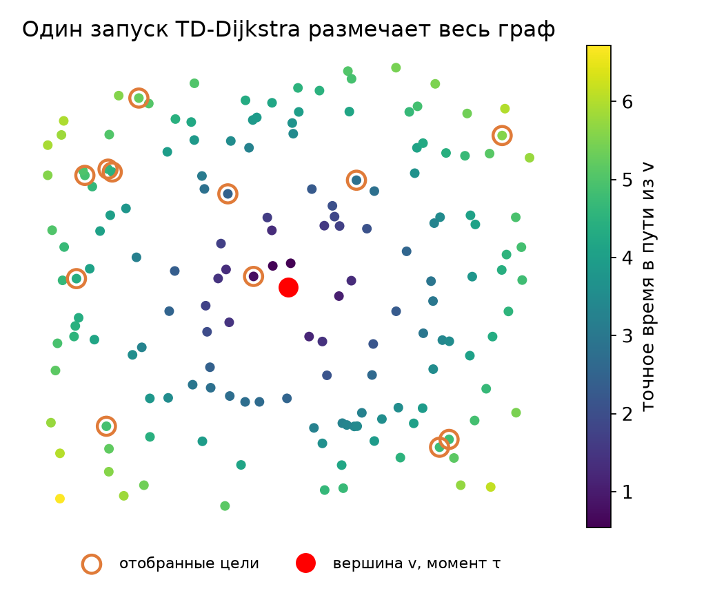

# Навигатор в час пик: можно ли научить A* угадывать пробки

*Черновик для Хабра, ПЗ-4 курса «Научное письмо». Научная версия: `article.tex` в этом репозитории.*

**Лид.** Навигатор строит маршрут за доли секунды, хотя дорожная сеть Москвы с областью — огромный граф из перекрёстков и участков дорог, а время проезда по каждой улице меняется в течение дня. Классический A* ищет маршрут быстро, когда хорошо оценивает оставшийся путь. В пробку эта оценка становится слишком оптимистичной, и поиск расползается. Я проверяю простую идею: пусть небольшая нейросеть подправляет оценку с учётом времени суток, а одна ручка α решает, сколько точности маршрута мы готовы отдать за скорость.

## Задача: самый быстрый маршрут, когда дороги «дышат»

Дорожную сеть удобно описывать ориентированным графом: вершины — перекрёстки, дуги — участки дорог. В обычной постановке у дуги есть вес, например длина или среднее время проезда. Для навигатора этого мало: одна и та же дуга в восемь утра и в полночь проезжается за разное время.

Поэтому вес дуги задают функцией: сколько минут займёт проезд, если въехать на дугу в момент τ ([Kaufman, Smith, 1993](https://doi.org/10.1080/10248079308903779)). Запрос к навигатору — это тройка «откуда, куда, когда выезжаем», а ответ — путь с минимальным временем в пути.

Важное свойство таких сетей называется FIFO: если въехать на дугу позже, то и съехать с неё раньше не получится. Обогнать самого себя, постояв на месте, нельзя. Пока FIFO выполняется, работает старый добрый алгоритм Дейкстры: он раскрывает вершины в порядке времени прибытия и находит оптимальный маршрут. Его версию для зависящих от времени весов называют TD-Dijkstra.

Проблема Дейкстры в том, что он ищет во все стороны сразу. Чтобы найти маршрут из Химок в Бутово, он честно переберёт всё, что ближе Бутово, включая Зеленоград.

## Почему A* в пробку слепнет

A* ([Hart, Nilsson, Raphael, 1968](https://doi.org/10.1109/TSSC.1968.300136)) отличается от Дейкстры одной деталью: к уже пройденному времени он прибавляет оценку оставшегося пути до цели — эвристику. Вершины, которые уводят от цели, получают большую сумму и раскрываются позже или не раскрываются вовсе. Чем точнее эвристика, тем уже область поиска.

У эвристики есть условие честности. Если она никогда не завышает оставшееся время (такую эвристику называют допустимой), A* гарантированно вернёт оптимальный маршрут. Для сетей с зависящими от времени весами стандартный способ получить допустимую оценку — посчитать её по весам свободного движения, то есть по самому быстрому времени проезда каждой дуги за сутки ([Delling, Wagner, 2007](https://doi.org/10.1007/978-3-540-72845-0_5)). Ночью такая оценка почти точна.

А в час пик реальное время в пути намного больше времени свободного движения. Оценка остаётся честной, но становится слишком оптимистичной, и A* снова расползается почти как Дейкстра. Обидно: хуже всего эвристика работает именно тогда, когда запросов больше всего.

Есть и совсем другой класс решений — иерархии сжатия для зависящих от времени весов, TCH и CATCHUp ([Batz и др., 2013](https://doi.org/10.1145/2444016.2444020); [Strasser, Wagner, Zeitz, 2021](https://doi.org/10.3390/a14030090)). Они отвечают на запросы очень быстро, но платят жёсткостью: при изменении данных иерархию надо перестраивать, а любое расширение постановки, например запреты поворотов, требует менять саму иерархию. A* такие расширения принимает почти без доработки ([Strasser, Zeitz, 2019](https://arxiv.org/abs/1910.12526)), поэтому за его эвристику стоит побороться.

## Что уже пробовали

Идея учить эвристику не нова. Графовая нейросеть PHIL обучается на траекториях поиска и сокращает число раскрытых вершин, но допустимость не гарантирует (Pándy и др., Learning on Graphs Conference, 2022). Futuhi и Sturtevant штрафуют завышение прямо в функции потерь и получают почти допустимую эвристику, правда, на кубике Рубика, а не на дорогах ([2025](https://arxiv.org/abs/2509.22626)).

Ближе всего к моей задаче работа Liashenko и Globa ([2026](https://doi.org/10.32620/reks.2026.1.12)). Они попробовали прямо предсказывать время в пути моделями LightGBM, GraphSAGE и GATv2 — и получили больше раскрытых вершин, чем с классической эвристикой. Выигрыш появился, когда нейросеть стала предсказывать скорость, а эвристику считали по геометрической формуле: так она осталась допустимой. Но проверка шла на графе из 2 400 вершин, на 10 парах вершин и трёх моментах времени. Что будет с недопустимой эвристикой с контролируемой ошибкой на сети большого города, из этой работы не видно.

Ещё одна старая идея — взвешенный A* ([Pohl, 1970](https://doi.org/10.1016/0004-3702(70)90007-X)): умножаем эвристику на коэффициент больше единицы, поиск раскрывает меньше вершин, а маршрут получается не хуже оптимального больше чем во столько же раз. Мой подход похож, только коэффициент не постоянный, а предсказан для каждой вершины и момента времени. Из-за этого гарантия Поля пропадает, и ошибку маршрута приходится измерять.

## Идея: не предсказывать время, а поправлять оценку

Вместо того чтобы заставлять нейросеть угадывать время в пути целиком, я оставляю честную оценку по свободному движению и прошу сеть предсказать только поправочный множитель: во сколько раз в это время суток реальный путь от вершины v до цели t длиннее оценки.

Формула эвристики:

h_α(v, t, τ) = h_LB(v, t) · exp(α · g(v, t, τ))

Здесь h_LB — нижняя оценка по весам свободного движения (ориентиры ALT, 16 штук), g — маленький многослойный перцептрон, а α от 0 до 1 — та самая ручка.

- При α = 0 множитель равен единице и мы получаем обычный допустимый A* с оптимальным маршрутом.
- При α = 1 используется полное предсказание сети. Оценка становится точнее, но иногда завышает оставшееся время, и маршрут может оказаться не самым быстрым.
- Промежуточные значения дают плавный переход между этими режимами.

Почему именно такая форма. Во-первых, предсказывать отношение проще, чем само время: масштаб расстояний уже сидит в h_LB, сети остаётся выучить «насколько сейчас хуже, чем ночью». Во-вторых, одна обученная модель даёт всю кривую «ускорение — ошибка»: достаточно перебрать α, переобучать ничего не нужно.

На вход перцептрон получает нормированные координаты вершин v и t, расстояние между ними по сфере, саму нижнюю оценку и время суток. Время кодируется парой синус-косинус, чтобы 23:59 и 00:00 оказались рядом. Два скрытых слоя по 64 нейрона, ReLU. Такая сеть считается на процессоре, и её время честно входит во время запроса: ускорение, которое съедается вычислением нейросети, никому не нужно.

## Откуда взять обучающие данные бесплатно

Чтобы учить сеть, нужны точные времена в пути для множества пар вершин и моментов отправления. Звучит дорого, но у TD-Dijkstra есть полезное свойство: один запуск из вершины v в момент τ даёт точное время до всех вершин графа сразу.

Поэтому выборка строится так:

1. Берём случайную вершину v и случайный момент τ в пределах суток.
2. Запускаем TD-Dijkstra и получаем время до всех вершин.
3. Отбираем часть целей t так, чтобы короткие и длинные пары были представлены поровну.

Целевая величина — логарифм отношения точного времени к нижней оценке, функция потерь — среднеквадратичная ошибка. Вершины для обучения и проверки не пересекаются, чтобы мерить обобщение на новые пары, а не запоминание.

Ещё одна деталь реализации. С недопустимой эвристикой вершину иногда раскрывают раньше, чем найден лучший путь до неё. Можно раскрывать её повторно, но тогда число раскрытий в худшем случае резко растёт — именно это и случилось с прямым предсказанием у Liashenko и Globa. Я вершины повторно не раскрываю: число раскрытий не превышает числа вершин, а вся цена недопустимости уходит в ошибку маршрута, которую легко измерить.

## Как я буду это проверять

Граф — Москва и Московская область из OpenStreetMap: дороги для легковых машин, наибольшая сильно связная компонента. Суточные профили скорости я строю сам по классу дороги: в утренний и вечерний пики скорость падает. Это честное ограничение: выводы будут относиться к модели загрузки, а не к реальным пробкам Москвы.

Сравниваю TD-Dijkstra, A* с допустимой нижней оценкой и A* с нейросетевой поправкой при α = 0,25; 0,5; 0,75 и 1. Для каждого запроса записываю три вещи:

- сколько вершин раскрыто;
- полное время запроса, включая нейросеть;
- относительную ошибку времени в пути по сравнению с оптимальным маршрутом.

Запросы подбираются по «рангу Дейкстры»: цель — вершина, которую TD-Dijkstra раскрыл под номером 2^r. Так в выборке поровну коротких поездок по району и длинных через всю область. Моменты отправления — ночь, утренний пик и день. По ошибке смотрю не только среднее, но и медиану, 95-й процентиль, максимум и долю запросов, где маршрут остался оптимальным. Все алгоритмы используют одно представление графа и одну очередь с приоритетами, чтобы разница во времени объяснялась эвристикой, а не кодом.

Вопросы, на которые должен ответить эксперимент:

1. Во сколько раз поправка сокращает число раскрытий и время запроса по сравнению с Дейкстрой и обычным A*?
2. Как ускорение и ошибка зависят от α, длины запроса и времени суток?
3. Окупается ли нейросеть по полному времени запроса, а не только по числу раскрытых вершин?

## Что дальше

Сейчас готовы постановка и протокол эксперимента. Цифры появятся во второй части, когда будут посчитаны замеры, и я покажу, где на кривой «ускорение — ошибка» находится разумная точка для навигатора. Если у вас есть опыт с обучаемыми эвристиками на реальных дорожных данных или вы знаете открытые суточные профили скоростей по Москве, напишите в комментариях: это сильно улучшит эксперимент.

*Работа выполняется на кафедре инженерной кибернетики НИТУ МИСИС.*

---

<!-- Перед публикацией: проверить, что картинки загружены в редактор Хабра; хабы — «Алгоритмы», «Машинное обучение», «Математика»; теги — A*, поиск маршрута, графы, нейросети, OpenStreetMap. Схемы 02 и 03 иллюстративные, подписи об этом есть. -->
